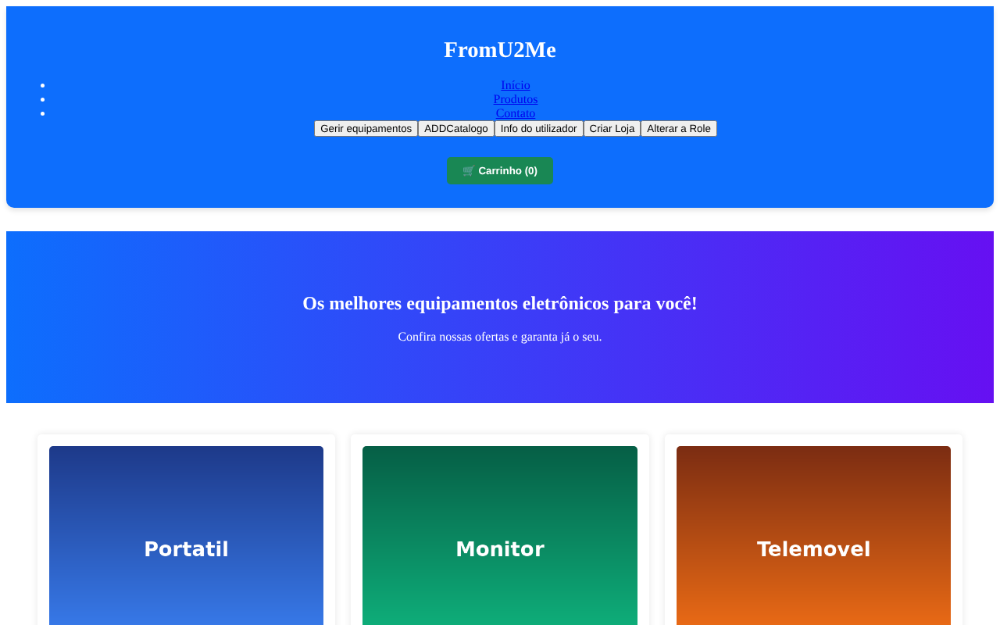
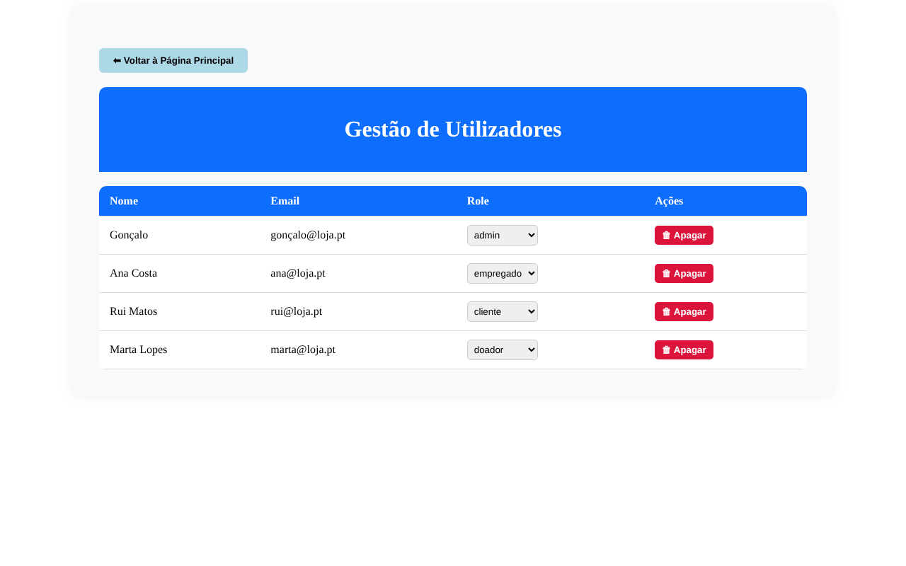
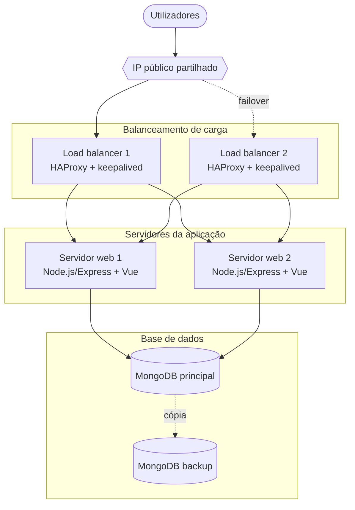

# Loja Online de Equipamentos Usados

> Projeto de grupo · Projeto de Tecnologias de Redes / Projeto de Tecnologias de Informação · LTI, FCUL · 2024/2025
>
> **Stack:** Node.js · Express 5 · MongoDB/Mongoose · Vue 3 · Vue Router · Pinia · JWT · bcryptjs · Helmet · Multer

| Catálogo | Gestão de utilizadores (admin) |
|---|---|
|  |  |

<sub>Capturas feitas com dados de demonstração.</sub>

Aplicação web onde as lojas registam equipamentos usados (com estado, preço, categoria e imagem) para os clientes comprarem. O modelo de dados também prevê doações a entidades sem fins lucrativos e a projetos beneficentes. Inclui:
- registo e autenticação com JWT; passwords guardadas com bcrypt
- perfis com várias roles (`cliente`, `doador`, `organizador`, `empregado`, `admin`) e uma página de gestão de utilizadores para admins e empregados
- catálogo com pesquisa, página de produto, carrinho (Pinia + `localStorage`) e registo de transações
- gestão de lojas, catálogos, categorias e tipos de equipamento
- upload de imagens com Multer

## Arquitetura e infraestrutura

A aplicação foi instalada em **6 máquinas virtuais no Google Cloud (Compute Engine)**, com redundância em todas as camadas:



| Camada | VMs | Função |
|--------|-----|--------|
| Balanceamento | 2 | **HAProxy** distribui os pedidos pelos dois servidores web. O **keepalived** mantém um IP partilhado entre os dois balanceadores e, se o ativo falhar, um script de *takeover* passa o IP para o outro. |
| Aplicação | 2 | API Node.js/Express e frontend Vue. As sessões ficam guardadas no MongoDB (`connect-mongo`) e não na memória do servidor, por isso qualquer um dos dois servidores pode atender qualquer pedido. |
| Dados | 2 | MongoDB principal, mais uma segunda instância de backup. |

As VMs e as respetivas configurações (`haproxy.cfg`, `keepalived.conf`, `takeover.sh`) foram desativadas no fim da cadeira e não estão neste repositório.

## Executar
```bash
cp .env.example .env      # preencher MONGO_URI e os segredos
npm install
node server.js            # API em http://localhost:3000/api
npm run serve             # frontend Vue em http://localhost:8080
npm test                  # testes da gestão de utilizadores (não precisa de MongoDB)
```

## Estrutura
```
server.js              # API Express
routes/ controllers/   # endpoints REST
models/                # esquemas Mongoose
middlewares/           # autenticação JWT
src/                   # frontend Vue 3 (components/, router/, stores/)
```

## Revisão para o portefólio
- **Gestão de utilizadores:** `GET/PUT/DELETE /api/utilizadores` não exigiam autenticação e devolviam as hashes das passwords e dados pessoais (NIF, NIC). Agora exigem um token válido e a role `admin` ou `empregado`, e nunca devolvem a password. Um utilizador pode editar o próprio perfil.
- **Escalada de privilégios:** era possível criar uma conta já como `admin` enviando `role` no registo, ou promover-se através do `PUT`. No registo só são aceites roles sem privilégios. Só gestores podem alterar roles, e só um admin pode atribuir `admin` ou `empregado`.
- **Login:** a resposta já não revela se o nome de utilizador existe.
- **Configuração:** o IP do servidor usado na entrega estava escrito diretamente em todo o frontend. Passou a vir de `VUE_APP_API_URL`, e as origens CORS de `CORS_ORIGINS`.
- **Catálogos:** as rotas `/api/catalogos` existiam mas não estavam montadas no servidor, por isso o formulário de registo de equipamentos não carregava os catálogos.
- O servidor deixa de arrancar sem `JWT_SECRET`. Foi removido código morto (ligação SQLite não utilizada).
- **Dependências:** o projeto usava `bcrypt` (nativo) e `bcryptjs` em sítios diferentes. Passou a usar só `bcryptjs`, que gera hashes compatíveis, e foram retiradas dependências nativas não usadas (`sqlite3`, `mysql2`), que impediam o `npm install` em máquinas sem ferramentas de compilação.
- **Testes novos** (`npm test`, sem precisar de MongoDB, com um modelo em memória): registo, login, listagem, edição e remoção de utilizadores e as regras de permissões por role — 5 testes, todos a passar.
- Foram retiradas imagens de teste que tinham ficado na pasta pública (incluindo arte de videojogos com direitos de autor).
- Testado: `npm install` e `npm run build` do frontend Vue sem erros.
